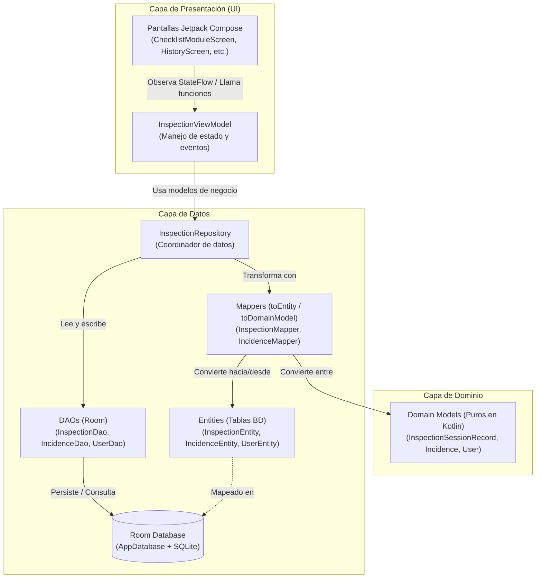

# Arquitectura y Guion de Video de la Aplicación

Este documento contiene el **Diagrama de Arquitectura / Clases** y el **Guion de Grabación** estructurado paso a paso con lenguaje claro, directo y accesible.

---

## 1. Diagrama de Arquitectura y Flujo de Datos

---

## 2. Guion de Grabación del Video

> **Consejo para el video:** Mantén un tono natural, seguro y pausado. En cada paso se indica qué archivo abrir en Android Studio y qué decir exactamente.

---

### **Escena 1: Introducción y Visión General**
* **Archivo en pantalla:** Abre el panel del proyecto mostrando la estructura de carpetas: `ui/`, `domain/` y `data/`.
* **Acción en pantalla:** Señala brevemente los 3 paquetes principales.
* **Qué decir:**
  > "Hola a todos. En este video les voy a explicar cómo está estructurada la arquitectura de la aplicación.
  > Diseñamos el proyecto siguiendo una arquitectura limpia y modular, separada en tres capas principales:
  > 1. La capa de **UI** con Jetpack Compose y ViewModels.
  > 2. La capa de **Dominio** con nuestros modelos de negocio.
  > 3. La capa de **Datos**, donde gestionamos la base de datos local con Room.
  > Vamos a ver cómo se comunican entre sí de forma ordenada."

---

### **Escena 2: Manipulación de Vistas con ViewModel**
* **Archivos en pantalla:**
  1. `app/src/main/java/com/example/dam_t1_evaluacion_practica/ui/screens/ChecklistModuleScreen.kt` (o cualquier pantalla de módulo).
  2. `app/src/main/java/com/example/dam_t1_evaluacion_practica/ui/viewmodel/InspectionViewModel.kt`
* **Acción en pantalla:**
  - En la pantalla, resalta dónde se reciben los datos del ViewModel (`viewModel.uiState` o funciones de eventos).
  - Cambia a `InspectionViewModel.kt` y muestra las variables de estado (`StateFlow`) y las funciones de acción (como guardar o cambiar respuestas).
* **Qué decir:**
  > "Primero, ¿cómo manejamos las vistas? 
  > Las pantallas no guardan datos por su cuenta ni hacen operaciones pesadas; son únicamente visuales. Toda la lógica y los datos viven en el **ViewModel**.
  > El ViewModel mantiene el estado de la pantalla vivo, incluso si el usuario gira el teléfono o cambia de vista. Cuando el usuario interactúa —por ejemplo, al marcar un checklist o pulsar guardar— la pantalla le avisa al ViewModel, este procesa la lógica y emite un nuevo estado que la vista simplemente dibuja en pantalla."

---

### **Escena 3: Persistencia con Room (Base de Datos Local)**
* **Archivos en pantalla:**
  1. `app/src/main/java/com/example/dam_t1_evaluacion_practica/data/local/AppDatabase.kt`
  2. `app/src/main/java/com/example/dam_t1_evaluacion_practica/data/local/dao/InspectionDao.kt`
* **Acción en pantalla:**
  - Muestra la anotación `@Database` en `AppDatabase.kt`.
  - Pasa a `InspectionDao.kt` y resalta las consultas `@Query`, `@Insert` y los retornos con `Flow`.
* **Qué decir:**
  > "Para que la información no se pierda al cerrar la app, usamos **Room**, la biblioteca oficial de Android para base de datos SQLite local.
  > Aquí en `AppDatabase` configuramos la base de datos y registramos nuestras tablas.
  > Y en los **DAOs**, como `InspectionDao`, definimos las operaciones: guardar una inspección, actualizarla o consultar el historial. Gracias a `Flow`, si los datos en la base cambian, la aplicación se actualiza de forma automática y en tiempo real."

---

### **Escena 4: Separación Limpia entre Entities y Domain Models (El punto clave)**
* **Archivos en pantalla (puedes ponerlos en pantalla dividida o cambiar entre ellos):**
  1. `app/src/main/java/com/example/dam_t1_evaluacion_practica/data/local/entity/InspectionEntity.kt`
  2. `app/src/main/java/com/example/dam_t1_evaluacion_practica/domain/model/InspectionSessionRecord.kt` (o `Inspection.kt`)
  3. `app/src/main/java/com/example/dam_t1_evaluacion_practica/data/mapper/InspectionMapper.kt`
* **Acción en pantalla:**
  - Muestra `InspectionEntity.kt` y resalta `@Entity`, `@PrimaryKey` y campos como strings JSON o tipos pensados para SQLite.
  - Muestra `InspectionSessionRecord.kt` y destaca que es una clase de Kotlin limpia, sin anotaciones de base de datos.
  - Abre `InspectionMapper.kt` y muestra las funciones de conversión `toEntity()` y `toDomainModel()`.
* **Qué decir:**
  > "Un detalle fundamental de una buena arquitectura es no mezclar la base de datos con las reglas de la aplicación.
  > Por eso tenemos dos tipos de modelos:
  > - Las **Entities** (como `InspectionEntity`): están diseñadas exclusivamente para la base de datos Room, con sus anotaciones, claves primarias y formatos planos.
  > - Los **Domain Models** (como `InspectionSessionRecord`): representan los datos limpios que la aplicación y las vistas necesitan entender.
  > ¿Cómo los conectamos? A través de **Mappers** en `InspectionMapper`. El mapper toma la entidad de la base de datos y la convierte en modelo de dominio, y viceversa.
  > Así, si el día de mañana cambiamos la base de datos o consumimos una API externa, nuestras vistas y lógica no se rompen."

---

### **Escena 5: Repositorio y Cierre**
* **Archivo en pantalla:** `app/src/main/java/com/example/dam_t1_evaluacion_practica/data/repository/InspectionRepository.kt`
* **Acción en pantalla:** Muestra cómo el repositorio usa el DAO y el Mapper para entregar datos limpios al ViewModel.
* **Qué decir:**
  > "Por último, el **Repository** actúa como el puente central: se comunica con los DAOs, usa los Mappers para transformar los datos y le entrega al ViewModel únicamente modelos limpios.
  > Con esto logramos una aplicación escalable, fácil de probar, con persistencia segura y código ordenado.
  > ¡Muchas gracias por su atención!"
